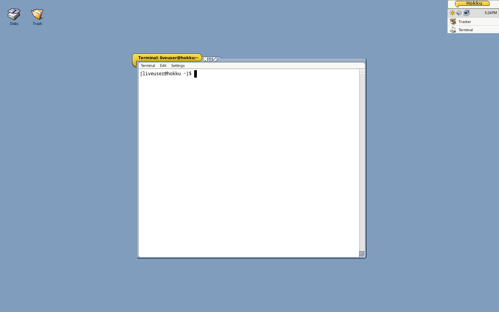

# Hokku OS

A CachyOS respin whose desktop is [Hokku](https://github.com/idumych/hokku): the Be/Haiku
API on Linux, with Haiku's Tracker and Deskbar running as Wayland clients of labwc.

It is CachyOS underneath (its kernels, repositories, hardware detection and Calamares
installer). The Plasma desktop is replaced with:

| | |
|---|---|
| Session | `hokku-session` (passes the system keyboard layout, as set by the installer or `localectl`, to labwc and Hokku), then `cosmoe-desktop.sh` from Hokku: labwc + Tracker + Deskbar (with a tray for other desktops' applets through TrayBridge: network, volume and Bluetooth start with the session; on a laptop, Hokku's own brightness slider) + Terminal, Xwayland for X11 apps, polkit-gnome, portals. Hokku's notification_server shows the desktop's notifications, and the Deskbar's menu lists every app, Hokku and Linux alike |
| Apps | Hokku's (Terminal, StyledEdit, ShowImage, Icon-O-Matic, DeskCalc…, and the demos) and three more built on it: [Folio](https://github.com/idumych/folio) (notebooks in Markdown), [Sheath](https://github.com/idumych/sheath) (a Bible reader on SWORD) and [Ringbinder](https://github.com/idumych/ringbinder) (a tabbed personal organizer), in the Deskbar's Applications menu |
| Look | [Gonx](https://github.com/idumych/gonx) throughout: new users start with what `gonx-theme apply` sets (window frame, controls, colours, fonts, plain desktop colour) from `/etc/skel`. labwc's frames for non-Be apps use Gonx's colours. `gonx-theme revert` goes back to Hokku's own look |
| Displays | wdisplays (resolution, scale, arrangement, rotation; in the Deskbar's applications menu) and kanshi, started from `/etc/xdg/labwc/autostart`, which applies the layouts in `~/.config/kanshi/config` at login |
| Login | greetd + tuigreet (the live ISO logs `liveuser` in automatically) |
| Installer | Calamares in offline mode: copies the live system to disk, then sets up greetd for Hokku |

Not affiliated with or endorsed by CachyOS.

## Screenshots

From the 1.0 (Icefell) ISO, in QEMU at 1280x800.



| | |
|---|---|
|  |  |
| The Deskbar menu: every Hokku app, plus Linux applications | Notifications from Linux apps, with their buttons and progress bars |
|  |  |
| The brightness slider (on a laptop; the VM's backlight was faked for this shot) | About this system |


## Hokku OS and Renku OS

Hokku OS and [Renku OS](https://github.com/RenkuOS/Source), the Haiku fork, run the same
API, so work done for one tends to land on the other. Notifications are one example:
Hokku OS needed buttons on its notifications (Reply and Mark read for a mail, Snooze for a
reminder). They were built in Hokku first, as `BNotification::AddAction()`. The same API was
then proposed to Renku OS
([RenkuOS/Source#233](https://github.com/RenkuOS/Source/pull/233)), which merged it the same
day, so an app can add those actions on both systems from one source (Renku's notification
server shows them as buttons once the second half, already written, lands). The other direction
works too: [Gonx](https://github.com/idumych/gonx), the look Hokku OS wears throughout, was
made for Renku OS, and Folio, Sheath and Ringbinder are Renku OS apps that Hokku OS builds
from the same source.

## Layout

```
packages/hokku/              PKGBUILD: hokku, hokku-apps, hokku-desktop (split) from the hokku
                             branch, plus Hokku fixes not yet pushed, as *.patch
packages/folio/, sheath/,     PKGBUILDs for those apps from their release tags, built against
  ringbinder/                the system Hokku (their release AppImages bundle their own)
packages/hokku-os-settings/  hokku-session, the Gonx settings for /etc/skel, labwc rc.xml
                             and its Gonx-coloured theme
iso/                         overlay on CachyOS's archiso profile (CachyOS-Live-ISO, pinned commit)
  packages.add / .remove       changes to CachyOS's packages_desktop.x86_64
  airootfs.remove              Plasma files dropped from CachyOS's airootfs
  airootfs/                    greetd, os-release, the installer launcher
scripts/build-packages.sh    clean-chroot builds into repo/x86_64 (the local [hokku] repo)
scripts/build-iso.sh         profile + overlay -> mkarchiso -> out/hokku-os-*.iso
scripts/test-iso.sh          boot the ISO / installed disk in QEMU, screenshots, keys, clicks
```

## Building

On an Arch-based host (CachyOS is fine: packages are built in a clean chroot with generic
x86-64 flags, not the host's `-march=native`):

```sh
sudo pacman -S --needed devtools archiso git curl
scripts/build-packages.sh
scripts/build-iso.sh
scripts/test-iso.sh start && scripts/test-iso.sh shot desktop
```

## Testing so far

From 27 to 30 October 2026, about 14 ISOs were built and booted in QEMU (`scripts/test-iso.sh`,
on a CPU without AVX so that nothing built for x86-64-v3 slips through). Testing them found
and fixed about 35 bugs: some 30 in Hokku (login hangs, Tracker and Terminal freezes, the
desktop and Deskbar lost after a text console, zombie apps, stale Deskbar entries, unfair
semaphores, apps untyped on ext4…), all in the hokku branch, and 5 or 6 in this repository's
packaging and build scripts. Real hardware has been tried far less than the VM.

## Known gaps

- Installed systems don't get Hokku updates yet: there's no hosted `[hokku]` pacman repository.
- Calamares still shows CachyOS's branding and slideshow; the boot splash images are CachyOS's.
- The installer's "log in automatically" option is ignored (greetd is set up without it).
- x86_64 only (CachyOS has no arm64 edition).
