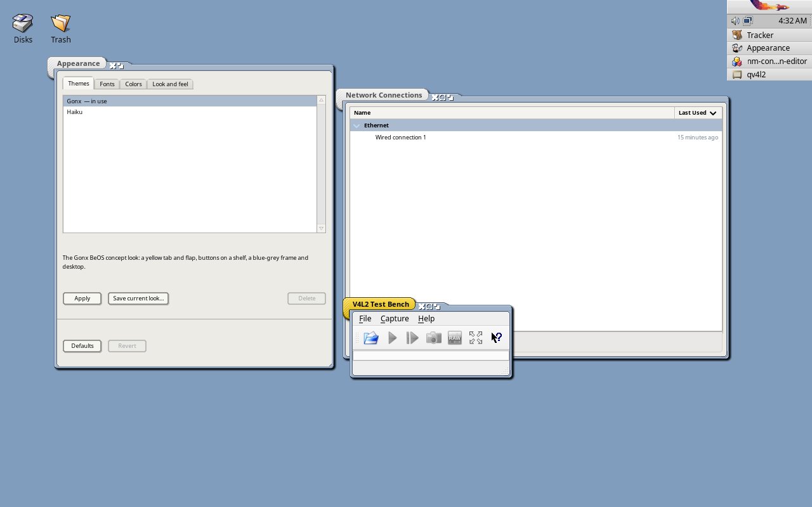

# Hokku OS

A CachyOS respin whose desktop is [Hokku](https://github.com/idumych/hokku), the Be/Haiku API
on Linux: Haiku's Tracker and Deskbar run as Wayland clients of labwc, and Linux apps share
the desktop with Be apps in the same look.

Underneath it is CachyOS (its kernels, repositories, hardware detection and Calamares
installer); Plasma is replaced with Hokku. Not affiliated with or endorsed by CachyOS.


## What's in it

| | |
|---|---|
| Desktop | Tracker and the Deskbar on labwc. The Deskbar's menu lists every app, Hokku and Linux alike; its tray holds other desktops' applets through TrayBridge (network, volume, Bluetooth) and, on a laptop, Hokku's brightness slider. Hokku's notification server shows every app's notifications. Xwayland runs X11 apps |
| Apps | Hokku's (Terminal, StyledEdit, ShowImage, Icon-O-Matic, DeskCalc…, and the demos) and three more built on it: [Folio](https://github.com/idumych/folio) (Markdown notebooks), [Sheath](https://github.com/idumych/sheath) (a Bible reader on SWORD) and [Ringbinder](https://github.com/idumych/ringbinder) (a personal organizer) |
| Look | [Gonx](https://github.com/idumych/gonx) or Haiku's own, switched in Appearance's Themes tab (or `hokku-theme apply`): window frames, controls, colours, fonts and desktop for Hokku apps, the same frames round every other window (labwc-hokku), and GTK 3 and Qt apps in matching themes and fonts. Windows and the BeOS pointer cast a soft shadow, which Appearance's Look and feel tab turns off. New users start in Gonx |
| Displays | wdisplays (resolution, scale, arrangement, rotation) and kanshi, which applies `~/.config/kanshi/config` at login |
| Login | greetd and tuigreet; `hokku-session` hands the system keyboard layout (from the installer or `localectl`) to labwc and Hokku. The live ISO logs `liveuser` in |
| Installer | Calamares in offline mode: copies the live system to disk, then sets up greetd for Hokku |

## Screenshots

In QEMU at 1280x800, from the 1.0 (Icefell) ISO, with development builds of Hokku where noted.

### The look

Appearance (a Hokku app), Network Connections (GTK 3) and V4L2 Test Bench (Qt 6) in each of
the two themes. All three wear the theme's frame (labwc-hokku draws it round the Linux apps
with Hokku's own frame code) and cast the same shadow; the Qt app is the active window. From
Hokku 7516f3a.




The Gonx controls in Hokku's Showcase and in the GTK and Qt test galleries, which copy its
layout:

| Hokku | GTK 3 | Qt (Kvantum) |
|---|---|---|
|  |  |  |

### The Deskbar

| | | |
|---|---|---|
|  |  |  |
| Every app, Hokku and Linux, in its menu | Linux apps' notifications, with their buttons and progress bars | The brightness slider (a laptop's; faked in the VM) |

### Apps built on Hokku

| Folio | Sheath | Ringbinder |
|---|---|---|
|  |  |  |

## Hokku OS and Renku OS

Hokku OS and [Renku OS](https://github.com/RenkuOS/Source), the Haiku fork, run the same API,
so work done for one tends to land on the other. Hokku OS needed buttons on notifications
(Reply and Mark read for a mail, Snooze for a reminder); they were built in Hokku as
`BNotification::AddAction()` and proposed to Renku OS, which merged them the same day
([RenkuOS/Source#233](https://github.com/RenkuOS/Source/pull/233)), so an app adds them on
both systems from one source. The other way round, [Gonx](https://github.com/idumych/gonx) was
made for Renku OS, and Folio, Sheath and Ringbinder are Renku OS apps that Hokku OS builds from
the same source.

## Building

On an Arch-based host (CachyOS is fine: packages are built in a clean chroot with generic
x86-64 flags, not the host's `-march=native`):

```sh
sudo pacman -S --needed devtools archiso git curl
scripts/build-packages.sh
scripts/build-iso.sh
scripts/test-iso.sh start && scripts/test-iso.sh shot desktop
```

`build-packages.sh` and `build-iso.sh` ask for sudo (makechrootpkg, mkarchiso).

## Layout

```
packages/
  hokku/               hokku, hokku-apps, hokku-desktop (split), from a pinned commit of
                       Hokku's hokku branch
  labwc-hokku/         Arch's labwc with a patch that draws Hokku's Haiku and Gonx frames,
                       and their shadow, round other apps' windows (window.decorator in the
                       theme); Hokku's frame code comes from packages/hokku's commit
  hokku-os-settings/   hokku-session, labwc's rc.xml and theme, and the Gonx look for
                       /etc/skel
  folio/, sheath/,     those apps from their release tags, built against the system Hokku
  ringbinder/          (their release AppImages bundle their own)
aur/
  hokku-git/           the hokku split for the AUR, from the hokku branch's latest commit
  labwc-hokku/         packages/labwc-hokku for the AUR (hokku-desktop-git suggests it)
iso/                   overlay on CachyOS's archiso profile (CachyOS-Live-ISO, pinned commit)
  packages.add/.remove   changes to CachyOS's package list
  airootfs.remove        Plasma files dropped from CachyOS's airootfs
  airootfs/              greetd, os-release, the installer launcher
scripts/
  build-packages.sh    clean-chroot builds into repo/x86_64 (the local [hokku] repo)
  build-iso.sh         profile + overlay -> mkarchiso -> out/hokku-os-*.iso
  test-iso.sh          boots the ISO or the installed disk in QEMU; screenshots, keys, clicks
```

## Testing so far

From 27 to 30 October 2026, about 14 ISOs were built and booted in QEMU (`scripts/test-iso.sh`,
on a CPU without AVX so that nothing built for x86-64-v3 slips through). That found and fixed
about 35 bugs: some 30 in Hokku (login hangs, Tracker and Terminal freezes, the desktop lost
after a text console, zombie apps, stale Deskbar entries, unfair semaphores, apps untyped on
ext4…), fixed in the hokku branch, and 5 or 6 in this repository's packaging and scripts.
Real hardware has been tried far less than the VM.

## Known gaps

- Installed systems don't get Hokku updates yet: there's no hosted `[hokku]` pacman repository.
- Calamares still shows CachyOS's branding and slideshow; the boot splash images are CachyOS's.
- The installer's "log in automatically" option is ignored (greetd is set up without it).
- x86_64 only (CachyOS has no arm64 edition).
- GTK 4 and libadwaita apps keep their own look. A Qt app shows a newly chosen style only after
  logging in again (a new font when it restarts), and Hokku apps' windows take a changed
  shadow setting when they restart.
